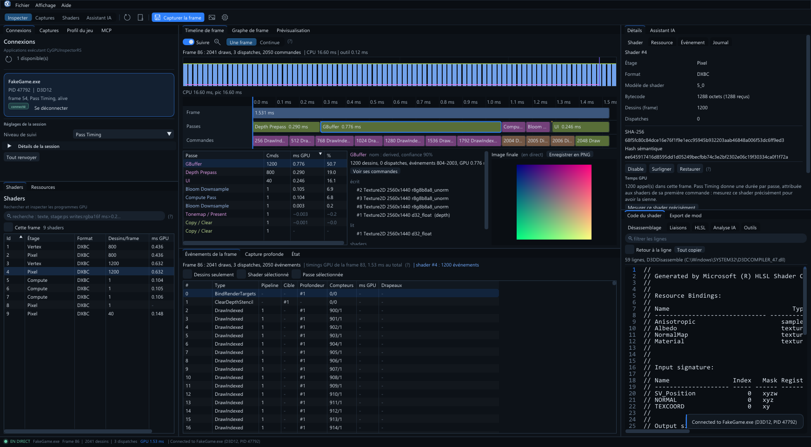
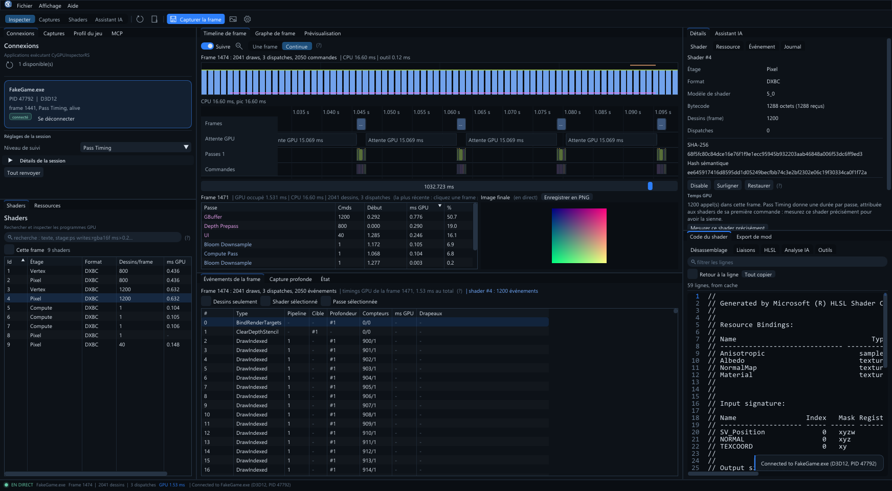
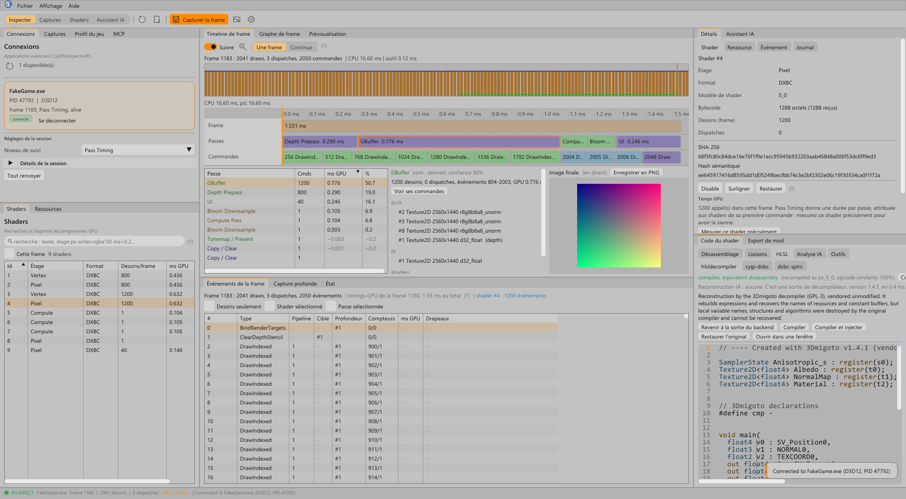

<table width="100%">
  <tr>
    <td width="300" align="left" valign="top">
      <a href="https://mrmybal.github.io/CyGPUInspector/Documentation.html#/fr/welcome">Documentation</a><br>
      <a href="https://github.com/MrMybal/CyGPUInspector">Dépôt</a><br>
      <a href="https://github.com/MrMybal/CyGPUInspector/issues">Suivi des problèmes</a><br><br>
      <sub>README</sub><br>
      <a href="README.md">English</a> · <a href="README.fr.md">Français</a>
    </td>
    <td width="400" align="center" valign="middle">
      
    </td>
    <td width="300" align="right" valign="top">
      <p><sub>Licence de l’application</sub><br><a href="LICENSE"><strong>AGPL-3.0-or-later</strong></a></p>
      <p><sub>Version</sub><br><a href="VERSION.fr.md"><strong>0.4.1</strong></a><br><strong>ALPHA — EXPÉRIMENTAL</strong></p>
      <p><a href="https://github.com/MrMybal/CyGPUInspector/releases/download/v0.4.1/CyGPUInspector-0.4.1-win64.zip"><strong>Télécharger</strong></a><br><sub>Windows x64 · portable</sub></p>
    </td>
  </tr>
</table>

<h1 align="center">CyGPUInspector</h1>

Un débogueur de frames GPU et un profileur pour les développeurs et les moddeurs de jeux Direct3D 11/12.
Inspectez shaders, ressources et temps GPU, reconstruisez du HLSL et comparez des frames enregistrées.
**ReShade assure la capture dans le jeu** ; l’analyse s’effectue dans une application Windows séparée.

> **ALPHA — EXPÉRIMENTAL · 0.4.1**
>
> Disponible pour les essais et les retours ; les fonctionnalités et la compatibilité peuvent
> être incomplètes. Cette version actualise le manuel anglais/français intégré et l’aide
> contextuelle. Consultez les [notes de version et limitations connues](VERSION.fr.md).

[](Assets/screenshots/frame-inspection.png)

Les captures montrent CyGPUInspector 0.4.0 avec la session de démonstration synthétique incluse.

## À propos de CyGPUInspector

Connectez-vous à un jeu en cours, sélectionnez une passe dans la timeline, puis retrouvez ses
événements, shaders et ressources. L’historique des frames aide à repérer les traitements coûteux ;
les réglages de canal, profondeur, mip et slice facilitent l’inspection d’une image GPU partagée.
Les noms des passes et leurs dépendances sont reconstruits à partir des événements observés ;
vous pouvez les renommer et les annoter.

[](Assets/screenshots/continuous-timeline.png)

L’observation continue et la capture profonde à la demande répondent à des besoins différents.
La capture profonde enregistre les liaisons des commandes, l’état des pipelines et les barrières ;
elle peut exporter l’image finale et les buffers capturés en PNG/DDS. Enregistrez des captures
ordinaires pour les inspecter ou les comparer sans le jeu. Aucun mode ne rejoue une frame ; les
captures ordinaires enregistrées ne conservent pas les pixels GPU disponibles en direct.

Consultez le désassemblage et la réflexion DXBC/DXIL, reconstruisez du HLSL avec quatre moteurs
de décompilation, modifiez-le avec les diagnostics du compilateur, puis testez un remplacement
compatible dans le jeu. Le HLSL reconstruit n’est pas le code source original.

[](Assets/screenshots/hlsl-editor-light.png)

## Fonctionnalités

- **Inspecter et profiler** : sessions connectées, shaders, ressources, événements, graphes de
  frame, temps par passe ou par draw et historique continu des frames.
- **Retrouver son travail** : profils par jeu, signatures persistantes des shaders, tags,
  annotations, shaders désactivés ou remplacés et comparaison de frames hors ligne.
- **Partager des modifications** : exportez un dossier `.cygimod` et appliquez-le avec
  `CyGPUInjector.addon64`, sans l’application d’analyse ni IPC.
- **Capturer dans Unreal** : le plugin capture l’éditeur et les builds Development/DebugGame
  depuis un bouton, une commande console ou un nœud Blueprint. Consultez le
  [guide Unreal](https://mrmybal.github.io/CyGPUInspector/Documentation.html#/fr/unreal).
- **Interroger un assistant IA** : Codex CLI, Claude Code CLI ou une API compatible OpenAI,
  locale ou distante, peut lire la frame avec les outils de l’application. Choisissez ses
  permissions ; ses résultats restent des hypothèses. Les agents externes utilisent
  `CyGPUInspectorMCP.exe` sur stdio ; le standalone applique un niveau MCP distinct,
  en lecture seule par défaut.
- **Lire le manuel complet** : [documentation en ligne](https://mrmybal.github.io/CyGPUInspector/Documentation.html#/fr/welcome)
  avec recherche, captures, schémas et références des API publiques C/C++. **F1** ou
  **Aide > Guide utilisateur** ouvre le même lecteur CyDoc hors ligne. L’anglais est la langue
  par défaut, avec une édition française complète ; le choix dans le lecteur ne modifie pas
  les préférences de l’application.

---

## Installation

L’application publiée est destinée à **Windows x64**. La capture en direct nécessite un jeu
Direct3D 11/12 compatible et ReShade avec **prise en charge complète des add-ons**.
Vulkan et OpenGL ne sont pas pris en charge.

1. [Téléchargez CyGPUInspector 0.4.1](https://github.com/MrMybal/CyGPUInspector/releases/download/v0.4.1/CyGPUInspector-0.4.1-win64.zip)
   et extrayez **toute** l’archive dans un dossier accessible en écriture.
2. Lancez `App/CyGPUInspectorApp.exe`. Gardez `Lang/`, `Documentation/` et les DLL des
   compilateurs à côté ; conservez les notices du dossier `LICENCES/` du paquet.
3. Commencez avec `TestWithoutAGame/Demo.cmd` pour explorer la session synthétique sans jeu.
4. Pour un vrai jeu, installez ReShade avec tous les add-ons, copiez
   `Addons/CyGPUInspectorRS.addon64` près de l’exécutable du jeu ou dans le dossier `AddonPath`
   de ReShade, lancez le jeu et connectez-vous depuis **Connexions**.

Consultez le [guide d’installation](https://mrmybal.github.io/CyGPUInspector/Documentation.html#/fr/installation)
et les [notes de publication / somme de contrôle](https://github.com/MrMybal/CyGPUInspector/releases/tag/v0.4.1).
Préservez réglages, disposition, base des shaders, profils de jeux et captures lors d’une mise à jour.

L’application utilise l’API officielle des add-ons ReShade. Elle ne contourne ni anti-triche,
ni protection, ni restriction sur ReShade. Les jeux qui refusent ReShade ne sont pas pris en charge.

## Sources, compilation et bibliothèques nécessaires

<details>
<summary>Compiler l’application Windows et régénérer son manuel hors ligne</summary>

Prérequis : Windows x64, Visual Studio 2022 avec les outils C++ pour le bureau (C++20, CMake et
Ninja), le SDK Windows et Node.js 22+ avec npm. Les dépendances natives sont dans `ThirdParty/` ;
l’archive CyDoc épinglée est dans `.CyDocBuild/vendor/`. La lecture du manuel généré ne nécessite pas Node.js.

```sh
git clone https://github.com/MrMybal/CyGPUInspector.git
cd CyGPUInspector
npm --prefix .CyDocBuild ci
build.cmd Release
```

Les sorties se trouvent dans `bin/Release/`. Lancez `CyGPUInspectorApp.exe`, ou exécutez
`CyGPUInspectorFakeSession.exe` et connectez-vous à `FakeGame.exe` pour essayer la démonstration.
Les options CMake `CYGI_BUILD_ADDON`, `CYGI_BUILD_INJECTOR`, `CYGI_BUILD_APP`,
`CYGI_BUILD_MCP` et `CYGI_BUILD_TESTS` sélectionnent les composants correspondants.

Pour régénérer uniquement le manuel : `npm --prefix .CyDocBuild run build`.
L’export comprend `Documentation/Documentation.html`, `DocData/` et un `DocAI.md` séparé ;
gardez le répertoire généré complet. Il fonctionne via `file://`, sans serveur.
Seul le module image de CyDoc est inclus ; les schémas statiques ne nécessitent ni graph ni Three.js.

Le standalone utilise certains modules de CyUI 1.2.0 avec sa propre instance Dear ImGui,
dont le CodeEditor natif. Les outils de shaders combinent 3Dmigoto, dxil-spirv, dxbc-spirv et
SPIRV-Cross. Microsoft DXC assure compilation et réflexion Shader Model 6 ; les paquets publiés
comprennent les DLL nécessaires. Le plugin Unreal se compile séparément ; consultez le
[guide Unreal](https://mrmybal.github.io/CyGPUInspector/Documentation.html#/fr/unreal).

</details>

### Showcase local

Les [sources du showcase bilingue](website/README.md) génèrent une présentation statique complète
avec de vraies captures et le lecteur CyDoc embarqué. Lancez `node website/build.mjs`, puis ouvrez
`build/showcase/site/index.html`, ou prévisualisez avec `node website/preview.mjs`.
Cette génération locale ne publie ni ne déploie le site.

---

## Licence

CyGPUInspector utilise la **[GNU Affero General Public License v3 ou ultérieure](LICENSE)**
(`AGPL-3.0-or-later`). Les composants tiers conservent leurs propres conditions.

### Bibliothèques tierces

| Bibliothèque · sources | Licence · texte | Utilisation / périmètre |
| --- | --- | --- |
| [ReShade SDK](https://github.com/crosire/reshade) | [BSD-3-Clause](LICENCES/ReShade-SDK/LICENSE.md) | En-têtes de l’API native des add-ons, 6.8.x / API 20. |
| [ReShade 6.8.0](https://reshade.me/) | [BSD-3-Clause](LICENCES/ReShade/LICENSE-ReShade.txt) · [notices des composants](LICENCES/ReShade/NOTICES-ReShade.txt) | DLL officielle avec tous les add-ons, livrée avec les paquets Unreal ; installation séparée pour les jeux ordinaires. |
| [CyUI 1.2.0](https://github.com/MrMybal/CyUI) | [MIT](LICENCES/CyUI/LICENSE.txt) · [texte amont](https://github.com/MrMybal/CyUI/blob/ff023e646c6a3038b3dfbfd53f6d2b4a2f5955e3/LICENSE) | Modules natifs sélectionnés ; sources amont privées. Sans moteur CEF ni audio. |
| [Dear ImGui](https://github.com/ocornut/imgui) | [MIT](LICENCES/DearImGui/LICENSE.txt) · [overlay](LICENCES/DearImGui-ReShade/LICENSE.txt) | Version docking 1.93 WIP dans l’app ; en-têtes 1.92.5 pour l’overlay ReShade. |
| [ImGuiColorTextEdit](https://github.com/goossens/ImGuiColorTextEdit) | [MIT](LICENCES/ImGuiColorTextEdit/LICENSE) | Moteur d’édition natif épinglé et adapté par CyUI. |
| [Lexilla](https://github.com/ScintillaOrg/lexilla), [Scintilla](https://github.com/mirror/scintilla), [SciTE](https://github.com/mirror/scite) | [Lexilla](LICENCES/Lexilla/License.txt) · [Scintilla](LICENCES/Scintilla/License.txt) · [SciTE](LICENCES/SciTE/License.txt) | Licences permissives ; moteurs de syntaxe, en-têtes d’interface et profils. Sans interface d’édition Scintilla. |
| [3Dmigoto](https://github.com/bo3b/3Dmigoto) | [GPL-3.0](LICENCES/3Dmigoto/LICENSE.GPL.txt) | Décompilateur HLSL ; sans son wrapper DirectX ni son code d’injection. |
| [dxil-spirv](https://github.com/HansKristian-Work/dxil-spirv) | [MIT](LICENCES/dxil-spirv/LICENSE.MIT) | Conversion DXIL → SPIR-V, version 2.73.0. |
| [dxbc-spirv](https://github.com/doitsujin/dxbc-spirv) | [MIT](LICENCES/dxbc-spirv/LICENSE) | Conversion DXBC → SPIR-V. |
| [SPIRV-Cross](https://github.com/KhronosGroup/SPIRV-Cross) | [Apache-2.0 OR MIT](LICENCES/SPIRV-Cross/LICENSE) | Conversion SPIR-V → HLSL ; conserver ses notices de composants. |
| [SPIR-V headers](https://github.com/KhronosGroup/SPIRV-Headers), [glslang](https://github.com/KhronosGroup/glslang), [RenderDoc](https://github.com/baldurk/renderdoc) | [Khronos](LICENCES/SPIRV-Headers/LICENSE) · [BSD-3-Clause](LICENCES/glslang-SPIR-V-builder/LICENSE.txt) · [MIT](LICENCES/RenderDoc-bitcode-reader/LICENSE.txt) | Composants de dxil-spirv : en-têtes, générateur SPIR-V et lecteur de bitcode LLVM. |
| [DirectX Shader Compiler](https://github.com/microsoft/DirectXShaderCompiler) | [Conditions de distribution](https://github.com/microsoft/DirectXShaderCompiler/blob/main/LICENSE.TXT) | dxcompiler.dll livré : LLVM/NCSA et MIT. dxil.dll : Microsoft Software License Terms distincts. Les textes complets accompagnent les DLL publiées. |
| Windows `d3dcompiler_47.dll` | Microsoft Windows | Compilateur, désassembleur et réflexion DXBC du système. |
| [CyDoc 0.1.0](https://github.com/MrMybal/CyDoc) | [MIT](LICENCES/CyDoc/LICENSE.txt) | Lecteur documentaire local ; module image uniquement. |
| [marked](https://github.com/markedjs/marked), [PrismJS](https://github.com/PrismJS/prism), [esbuild](https://github.com/evanw/esbuild) | [MIT: marked](LICENCES/CyDoc/marked-LICENSE.md) · [PrismJS](LICENCES/CyDoc/prismjs-LICENSE) · [esbuild](LICENCES/CyDoc/esbuild-LICENSE.md) | Compilation Markdown, coloration et assemblage à la génération ; aucun service documentaire installé. |
| [Playwright](https://github.com/microsoft/playwright) | [Apache-2.0](https://github.com/microsoft/playwright/blob/v1.56.1/LICENSE) | Vérification dans le navigateur pendant le développement ; non livré avec le lecteur. |

Ce tableau est un index. Conservez les [notices complètes de distribution](LICENCES/),
la [provenance des composants](THIRD-PARTY.md) et les notices supplémentaires des versions binaires.
CyToolsCore et CyUEMCPSDK ne sont pas des dépendances incluses dans cette application.

## Références et liens

- [Documentation française](https://mrmybal.github.io/CyGPUInspector/Documentation.html#/fr/welcome) · [English documentation](https://mrmybal.github.io/CyGPUInspector/Documentation.html#/en/welcome).
- [Notes de version et limitations](VERSION.fr.md) · [Publications](https://github.com/MrMybal/CyGPUInspector/releases).
- [Dépôt des sources](https://github.com/MrMybal/CyGPUInspector) · [Suivi des problèmes](https://github.com/MrMybal/CyGPUInspector/issues).
- [Modes de capture](https://mrmybal.github.io/CyGPUInspector/Documentation.html#/fr/capture) · [Mods de shaders](https://mrmybal.github.io/CyGPUInspector/Documentation.html#/fr/mods) · [Assistant IA](https://mrmybal.github.io/CyGPUInspector/Documentation.html#/fr/ai) · [Agents MCP externes](https://mrmybal.github.io/CyGPUInspector/Documentation.html#/fr/mcp).
