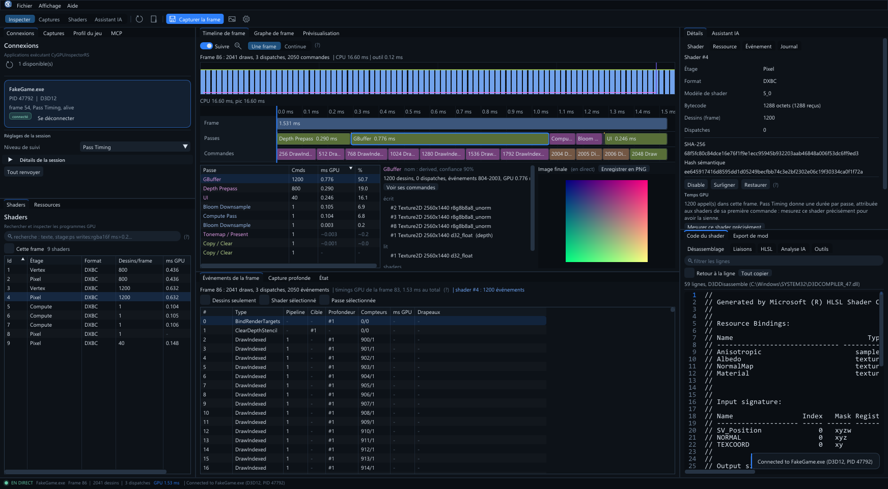
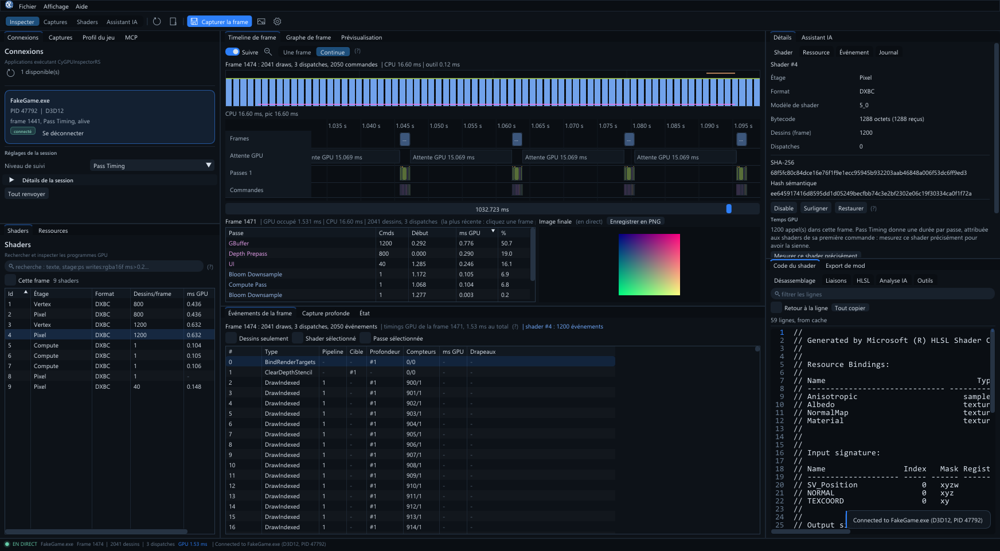
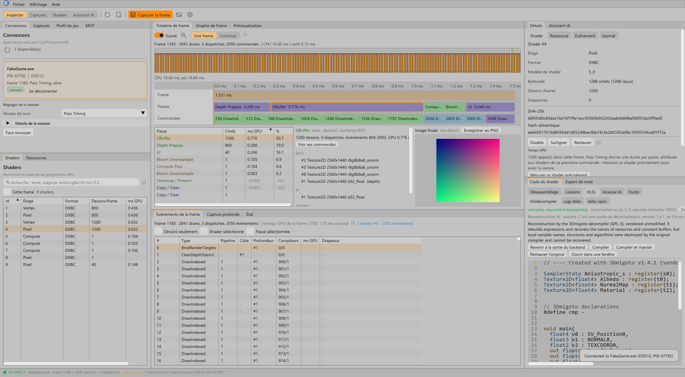

<table width="100%">
  <tr>
    <td width="300" align="left" valign="top">
      <a href="https://mrmybal.github.io/CyGPUInspector/Documentation.html#/en/welcome">Documentation</a><br>
      <a href="https://github.com/MrMybal/CyGPUInspector">Repository</a><br>
      <a href="https://github.com/MrMybal/CyGPUInspector/issues">Issue tracker</a><br><br>
      <sub>README</sub><br>
      <a href="README.md">English</a> · <a href="README.fr.md">Français</a>
    </td>
    <td width="400" align="center" valign="middle">
      
    </td>
    <td width="300" align="right" valign="top">
      <p><sub>Application license</sub><br><a href="LICENSE"><strong>AGPL-3.0-or-later</strong></a></p>
      <p><sub>Version</sub><br><a href="VERSION.md"><strong>0.4.1</strong></a><br><strong>ALPHA — EXPERIMENTAL</strong></p>
      <p><a href="https://github.com/MrMybal/CyGPUInspector/releases/download/v0.4.1/CyGPUInspector-0.4.1-win64.zip"><strong>Download</strong></a><br><sub>Windows x64 · portable</sub></p>
    </td>
  </tr>
</table>

<h1 align="center">CyGPUInspector</h1>

A GPU frame debugger and profiler for developers and modders working with Direct3D 11/12 games.
Inspect shaders, resources and timings, reconstruct HLSL and compare saved frames. **ReShade is
the capture agent inside the game**; analysis runs in a separate Windows application.

> **ALPHA — EXPERIMENTAL · 0.4.1**
>
> Available for testing and feedback; features and compatibility may be incomplete. This release
> updates the integrated English/French manual and contextual help. Read the
> [version notes and known limitations](VERSION.md).

[](Assets/screenshots/frame-inspection.png)

Screenshots show CyGPUInspector 0.4.0 with the included synthetic demo session.

## About CyGPUInspector

Connect to a running game, select a pass in the timeline, then follow its events, shaders and
resources. The live frame history helps locate expensive work; channel, depth, mip and slice
controls help inspect a shared GPU image. Pass names and dependencies are reconstructed from
observed events and can be renamed or annotated.

[](Assets/screenshots/continuous-timeline.png)

Continuous observation and on-demand deep capture serve different tasks. A deep capture records
command bindings, pipeline state and barriers, and can export the final image and captured
buffers as PNG/DDS. Save ordinary frame captures to inspect or compare them without the game.
Neither capture mode replays a frame; ordinary saved captures do not retain live GPU pixels.

Browse DXBC/DXIL disassembly and reflection, reconstruct HLSL with four decompilation backends,
edit it with compiler diagnostics, then test a compatible replacement in the running game.
Reconstructed HLSL is not the original source.

[](Assets/screenshots/hlsl-editor-light.png)

## Features

- **Inspect and profile:** connected sessions, shaders, resources, events, frame graphs,
  per-pass/per-draw timings and continuous frame history.
- **Keep work between sessions:** per-game profiles, persistent shader signatures, tags,
  annotations, disabled/replaced shaders and offline frame comparisons.
- **Share shader changes:** export a `.cygimod` folder and apply it with
  `CyGPUInjector.addon64`, without the analysis application or IPC.
- **Capture in Unreal:** the plugin captures the editor and Development/DebugGame builds from
  a toolbar button, console command or Blueprint node. See the
  [Unreal guide](https://mrmybal.github.io/CyGPUInspector/Documentation.html#/en/unreal).
- **Ask an AI assistant:** Codex CLI, Claude Code CLI or an OpenAI-compatible local/remote API
  can inspect frame data with the application's tools. Choose its permissions; model results
  remain hypotheses. External agents can use `CyGPUInspectorMCP.exe` over stdio; the standalone
  enforces its separate MCP permission level, read only by default.
- **Read the complete manual:** [online documentation](https://mrmybal.github.io/CyGPUInspector/Documentation.html#/en/welcome)
  with search, screenshots, diagrams and public C/C++ API references. **F1** or
  **Help > User guide** opens the same CyDoc reader offline. English is the default, with a
  complete French edition; the reader's language choice does not change app preferences.

---

## Installation

The published application is **Windows x64**. Live capture requires a supported Direct3D 11/12
game and ReShade with **full add-on support**. Vulkan and OpenGL are not supported.

1. [Download CyGPUInspector 0.4.1](https://github.com/MrMybal/CyGPUInspector/releases/download/v0.4.1/CyGPUInspector-0.4.1-win64.zip)
   and extract the **entire** archive into a writable folder.
2. Start `App/CyGPUInspectorApp.exe`. Keep `Lang/`, `Documentation/` and the supplied compiler
   DLLs beside it; retain the package's `LICENCES/` notices.
3. Start with `TestWithoutAGame/Demo.cmd` to explore the synthetic session without a game.
4. For a real game, install the full add-on-enabled ReShade build, copy
   `Addons/CyGPUInspectorRS.addon64` next to the game's executable or into ReShade's `AddonPath`,
   start the game and connect from **Connections**.

See the [installation guide](https://mrmybal.github.io/CyGPUInspector/Documentation.html#/en/installation)
and [release notes/checksum](https://github.com/MrMybal/CyGPUInspector/releases/tag/v0.4.1).
Preserve your settings, layout, shader database, game profiles and captures when updating.

The application uses ReShade's official add-on API. It does not bypass anti-cheat, protection
or restrictions on ReShade. Games that refuse ReShade are unsupported.

## Source, build and required libraries

<details>
<summary>Build the Windows application and regenerate its offline manual</summary>

Requirements: Windows x64, Visual Studio 2022 with Desktop C++ tools (C++20, CMake and Ninja),
the Windows SDK, and Node.js 22+ with npm. Native dependencies are vendored in `ThirdParty/`;
the pinned CyDoc archive is in `.CyDocBuild/vendor/`. Reading the generated manual needs no Node.js.

```sh
git clone https://github.com/MrMybal/CyGPUInspector.git
cd CyGPUInspector
npm --prefix .CyDocBuild ci
build.cmd Release
```

Output goes to `bin/Release/`. Start `CyGPUInspectorApp.exe`, or run
`CyGPUInspectorFakeSession.exe` and connect to `FakeGame.exe` to try the demo.
The CMake options `CYGI_BUILD_ADDON`, `CYGI_BUILD_INJECTOR`, `CYGI_BUILD_APP`,
`CYGI_BUILD_MCP` and `CYGI_BUILD_TESTS` select the corresponding components.

Regenerate just the manual with `npm --prefix .CyDocBuild run build`.
The export is `Documentation/Documentation.html` with `DocData/` and a separate `DocAI.md`;
keep the complete generated directory. It works through `file://` without a server.
Only CyDoc's image module is included; static diagrams do not require graph or Three.js.

The standalone uses selected CyUI 1.2.0 modules with its own Dear ImGui instance, including the
native CodeEditor. Shader tools combine 3Dmigoto, dxil-spirv, dxbc-spirv and SPIRV-Cross.
Microsoft DXC supplies Shader Model 6 compilation/reflection; release packages include the
required DLLs. The Unreal plugin is a separate build; follow the
[Unreal guide](https://mrmybal.github.io/CyGPUInspector/Documentation.html#/en/unreal).

</details>

---

## License

CyGPUInspector uses the **[GNU Affero General Public License v3 or later](LICENSE)**
(`AGPL-3.0-or-later`). Third-party components retain their own terms.

### Third-party libraries

| Library · source | License · terms | Use / scope |
| --- | --- | --- |
| [ReShade SDK](https://github.com/crosire/reshade) | [BSD-3-Clause](LICENCES/ReShade-SDK/LICENSE.md) | Native add-on API headers, 6.8.x / API 20. |
| [ReShade 6.8.0](https://reshade.me/) | [BSD-3-Clause](LICENCES/ReShade/LICENSE-ReShade.txt) · [component notices](LICENCES/ReShade/NOTICES-ReShade.txt) | Official full-add-on DLL bundled with Unreal packages; installed separately for ordinary games. |
| [CyUI 1.2.0](https://github.com/MrMybal/CyUI) | [MIT](LICENCES/CyUI/LICENSE.txt) · [upstream](https://github.com/MrMybal/CyUI/blob/ff023e646c6a3038b3dfbfd53f6d2b4a2f5955e3/LICENSE) | Selected native interface modules; private upstream source. No CEF or audio runtime. |
| [Dear ImGui](https://github.com/ocornut/imgui) | [MIT](LICENCES/DearImGui/LICENSE.txt) · [overlay](LICENCES/DearImGui-ReShade/LICENSE.txt) | 1.93 WIP docking in the app; 1.92.5 headers for the ReShade overlay. |
| [ImGuiColorTextEdit](https://github.com/goossens/ImGuiColorTextEdit) | [MIT](LICENCES/ImGuiColorTextEdit/LICENSE) | CyUI's pinned/patched native editor backend. |
| [Lexilla](https://github.com/ScintillaOrg/lexilla), [Scintilla](https://github.com/mirror/scintilla), [SciTE](https://github.com/mirror/scite) | [Lexilla](LICENCES/Lexilla/License.txt) · [Scintilla](LICENCES/Scintilla/License.txt) · [SciTE](LICENCES/SciTE/License.txt) | Permissive licenses; syntax engines, interface headers and profile data. No Scintilla editing UI. |
| [3Dmigoto](https://github.com/bo3b/3Dmigoto) | [GPL-3.0](LICENCES/3Dmigoto/LICENSE.GPL.txt) | HLSL decompiler; not its DirectX wrapper or injection code. |
| [dxil-spirv](https://github.com/HansKristian-Work/dxil-spirv) | [MIT](LICENCES/dxil-spirv/LICENSE.MIT) | DXIL → SPIR-V conversion, 2.73.0. |
| [dxbc-spirv](https://github.com/doitsujin/dxbc-spirv) | [MIT](LICENCES/dxbc-spirv/LICENSE) | DXBC → SPIR-V conversion. |
| [SPIRV-Cross](https://github.com/KhronosGroup/SPIRV-Cross) | [Apache-2.0 OR MIT](LICENCES/SPIRV-Cross/LICENSE) | SPIR-V → HLSL conversion; retain its component notices. |
| [SPIR-V headers](https://github.com/KhronosGroup/SPIRV-Headers), [glslang](https://github.com/KhronosGroup/glslang), [RenderDoc](https://github.com/baldurk/renderdoc) | [Khronos](LICENCES/SPIRV-Headers/LICENSE) · [BSD-3-Clause](LICENCES/glslang-SPIR-V-builder/LICENSE.txt) · [MIT](LICENCES/RenderDoc-bitcode-reader/LICENSE.txt) | Components inside dxil-spirv: headers, SPIR-V builder and LLVM bitcode reader. |
| [DirectX Shader Compiler](https://github.com/microsoft/DirectXShaderCompiler) | [Distribution terms](https://github.com/microsoft/DirectXShaderCompiler/blob/main/LICENSE.TXT) | Bundled dxcompiler.dll: LLVM/NCSA and MIT. dxil.dll: separate Microsoft Software License Terms. Full texts accompany release DLLs. |
| Windows `d3dcompiler_47.dll` | Microsoft Windows | System DXBC compiler, disassembler and reflection. |
| [CyDoc 0.1.0](https://github.com/MrMybal/CyDoc) | [MIT](LICENCES/CyDoc/LICENSE.txt) | Local documentation reader; image module only. |
| [marked](https://github.com/markedjs/marked), [PrismJS](https://github.com/PrismJS/prism), [esbuild](https://github.com/evanw/esbuild) | [MIT: marked](LICENCES/CyDoc/marked-LICENSE.md) · [PrismJS](LICENCES/CyDoc/prismjs-LICENSE) · [esbuild](LICENCES/CyDoc/esbuild-LICENSE.md) | Build-time Markdown, highlighting and bundling; not an installed documentation service. |
| [Playwright](https://github.com/microsoft/playwright) | [Apache-2.0](https://github.com/microsoft/playwright/blob/v1.56.1/LICENSE) | Development-only browser verification; not shipped with the reader. |

This table is an index. Keep the full [distribution notices](LICENCES/),
[component provenance](THIRD-PARTY.md) and additional notices supplied with binary releases.
CyToolsCore and CyUEMCPSDK are not included dependencies of this application.

## References and links

- [English documentation](https://mrmybal.github.io/CyGPUInspector/Documentation.html#/en/welcome) · [Documentation française](https://mrmybal.github.io/CyGPUInspector/Documentation.html#/fr/welcome).
- [Version notes and limitations](VERSION.md) · [Releases](https://github.com/MrMybal/CyGPUInspector/releases).
- [Source repository](https://github.com/MrMybal/CyGPUInspector) · [Issue tracker](https://github.com/MrMybal/CyGPUInspector/issues).
- [Capture modes](https://mrmybal.github.io/CyGPUInspector/Documentation.html#/en/capture) · [Shader mods](https://mrmybal.github.io/CyGPUInspector/Documentation.html#/en/mods) · [AI assistant](https://mrmybal.github.io/CyGPUInspector/Documentation.html#/en/ai) · [External MCP agents](https://mrmybal.github.io/CyGPUInspector/Documentation.html#/en/mcp).
